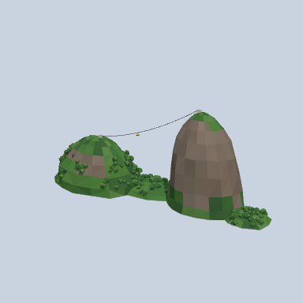
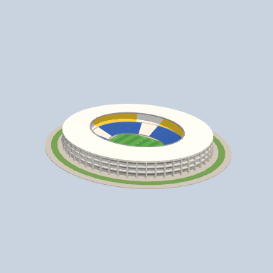
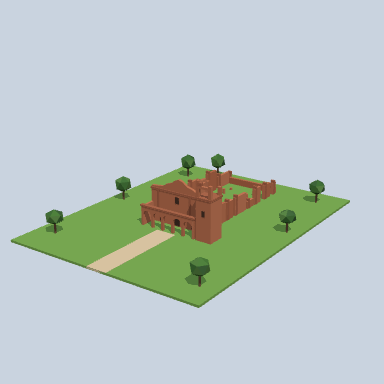
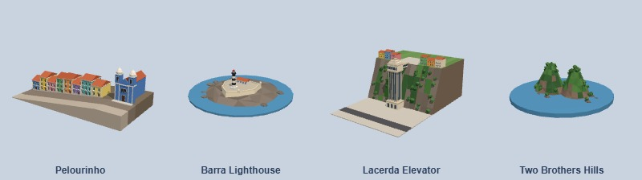
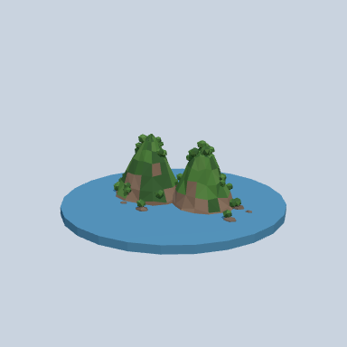

# Scitizia Landmarks 64: 17 low poly Brazilian landmarks in glTF/GLB (CC0)


**Scitizia Landmarks 64** is a free pack of **17 famous Brazilian landmarks** modeled in low poly with a retro 64-bit console look, from all five regions of Brazil: Christ the Redeemer, Sugarloaf Mountain, Maracanã, the Niterói Contemporary Art Museum, MASP, São Paulo's cable-stayed bridge, the Curitiba Botanical Garden greenhouse, the São Miguel das Missões ruins, the National Congress, the Cathedral of Brasília, the JK Bridge, Pelourinho, Barra Lighthouse, the Lacerda Elevator, the Two Brothers Hills of Fernando de Noronha, the Amazon Theatre and the Ver-o-Peso iron market. Each one is a single binary glTF 2.0 file (`.glb`, 1,136 to 3,920 triangles) at approximate real-world scale, with flat-shaded faces, vertex colors and no textures, ready for real-time games, maps, dioramas and backgrounds. They were made for the opening trailer and the world of the browser racing game **Kaltror Rally**. Public domain (CC0 1.0).

## At a glance

| | |
|---|---|
| Models | 17: Southeast (6) · South (2) · Central-West (3) · Northeast (4) · North (2) |
| Format | binary glTF 2.0 (`.glb`), one object per file |
| Triangles | 1,136 to 3,920 per model (average 2,488) |
| File size | 93.3 to 424.9 KB |
| Materials | `liso` (vertex color, roughness 0.92) and `vidro` (glass, vertex color, roughness 0.3); no textures |
| Scale and axes | real-world meters (approximate), Y up, front facing +Z, origin at the center of the base with ground level at Y = 0 |
| Machine-readable catalog | [`catalogo.json`](catalogo.json) |
| Author | Kayque Rotondo |
| License | public domain, [CC0 1.0](LICENSE) |

## Southeast


| Preview | Landmark | City / State | Description | Triangles | Size (W × H × D) | File |
|---|---|---|---|---|---|---|
|  | **Christ the Redeemer**<br>Cristo Redentor<br>[`cristo_redentor.glb`](modelos/cristo_redentor.glb) | Rio de Janeiro, RJ | Open-armed statue on top of Corcovado hill, with its pedestal, the viewing terrace and the forested hill | 2,018 | 383 × 195 × 163 m | 215.8 KB |
|  | **Sugarloaf Mountain**<br>Pão de Açúcar<br>[`pao_de_acucar.glb`](modelos/pao_de_acucar.glb) | Rio de Janeiro, RJ | Sugarloaf and Urca hills with forest, both cable car stations and the cabin hanging on the cable | 3,898 | 1,105 × 406 × 365 m | 424.9 KB |
|  | **Maracanã Stadium**<br>Maracanã<br>[`maracana.glb`](modelos/maracana.glb) | Rio de Janeiro, RJ | Low elliptical bowl with the open facade of slanted pillars, ring beams, white roof, blue and yellow stands and the striped pitch | 3,920 | 380 × 35.4 × 336 m | 269.4 KB |
|  | **Niterói Contemporary Art Museum**<br>MAC Niterói<br>[`mac_niteroi.glb`](modelos/mac_niteroi.glb) | Niterói, RJ | The white saucer on its central column, the window band, the reflecting pool, the curving red ramp and the rocky lookout over the sea | 2,444 | 156 × 28.6 × 156 m | 177.8 KB |
|  | **São Paulo Museum of Art**<br>MASP<br>[`masp.glb`](modelos/masp.glb) | São Paulo, SP | Glass box hung from the red portal frames over the open span, with the belvedere and its trees | 1,512 | 124 × 24.1 × 92.0 m | 127.1 KB |
|  | **São Paulo Cable-Stayed Bridge**<br>Ponte Estaiada<br>[`ponte_estaiada.glb`](modelos/ponte_estaiada.glb) | São Paulo, SP | 138 m X-shaped pylon with fans of stay cables and two curved decks crossing at different levels over the river and its riverside roads | 1,584 | 460 × 144 × 430 m | 128.3 KB |

## South


| Preview | Landmark | City / State | Description | Triangles | Size (W × H × D) | File |
|---|---|---|---|---|---|---|
|  | **Botanical Garden Greenhouse**<br>Estufa do Jardim Botânico<br>[`estufa_jardim_botanico.glb`](modelos/estufa_jardim_botanico.glb) | Curitiba, PR | Iron-and-glass greenhouse with a central dome and two vaulted wings, and the formal garden with flower beds, fountains and clipped conifers | 3,260 | 92.0 × 24.1 × 94.0 m | 249.9 KB |
|  | **São Miguel das Missões Ruins**<br>Ruínas de São Miguel das Missões<br>[`sao_miguel_das_missoes.glb`](modelos/sao_miguel_das_missoes.glb) | São Miguel das Missões, RS | Red sandstone church facade with the five-arch portico, the pediment and the ruined bell tower, the remains of the nave walls and the open field | 1,620 | 96.0 × 27.5 × 126 m | 122.8 KB |

## Central-West


| Preview | Landmark | City / State | Description | Triangles | Size (W × H × D) | File |
|---|---|---|---|---|---|---|
|  | **National Congress**<br>Congresso Nacional<br>[`congresso_nacional.glb`](modelos/congresso_nacional.glb) | Brasília, DF | Twin H-shaped towers, the Senate dome, the upturned bowl of the Chamber, the long platform, the ramp and the reflecting pools | 2,756 | 300 × 101 × 260 m | 196.6 KB |
|  | **Cathedral of Brasília**<br>Catedral de Brasília<br>[`catedral_brasilia.glb`](modelos/catedral_brasilia.glb) | Brasília, DF | 16 curved concrete columns forming a hyperboloid, blue, green and white stained glass, the reflecting pool, the bell tower and the four evangelists | 3,322 | 150 × 43.1 × 150 m | 249.1 KB |
|  | **JK Bridge**<br>Ponte JK<br>[`ponte_jk.glb`](modelos/ponte_jk.glb) | Brasília, DF | Three asymmetric steel arches crossing the deck diagonally, the hangers, the piers and the lake (1.2 km end to end) | 3,056 | 1,260 × 65.8 × 220 m | 227.7 KB |

## Northeast



| Preview | Landmark | City / State | Description | Triangles | Size (W × H × D) | File |
|---|---|---|---|---|---|---|
|  | **Pelourinho**<br>[`pelourinho.glb`](modelos/pelourinho.glb) | Salvador, BA | Sloping street of colourful colonial townhouses with balconies and tiled roofs, and the blue church at the top | 2,564 | 92.0 × 32.1 × 48.0 m | 196.4 KB |
|  | **Barra Lighthouse**<br>Farol da Barra<br>[`farol_da_barra.glb`](modelos/farol_da_barra.glb) | Salvador, BA | Stone fort with sentry boxes on a rocky point, the keeper's house and the black-and-white striped lighthouse | 1,136 | 128 × 35.8 × 128 m | 93.3 KB |
|  | **Lacerda Elevator**<br>Elevador Lacerda<br>[`elevador_lacerda.glb`](modelos/elevador_lacerda.glb) | Salvador, BA | 72 m art deco tower at the foot of the escarpment, the footbridge to the Upper Town, the houses along the top and the Lower Town square | 2,664 | 120 × 77.4 × 180 m | 234.3 KB |
|  | **Two Brothers Hills**<br>Morro Dois Irmãos<br>[`morro_dois_irmaos.glb`](modelos/morro_dois_irmaos.glb) | Fernando de Noronha, PE | Twin rock hills rising from the sea, with forest on top and rocks at the waterline | 1,620 | 160 × 52.8 × 160 m | 174.9 KB |

## North


| Preview | Landmark | City / State | Description | Triangles | Size (W × H × D) | File |
|---|---|---|---|---|---|---|
|  | **Amazon Theatre**<br>Teatro Amazonas<br>[`teatro_amazonas.glb`](modelos/teatro_amazonas.glb) | Manaus, AM | Pink opera house with white colonnade and pediment, the green, yellow and blue mosaic dome and the square with its wave-patterned pavement | 3,278 | 120 × 43.7 × 145 m | 251.1 KB |
|  | **Ver-o-Peso Iron Market**<br>Ver-o-Peso<br>[`ver_o_peso.glb`](modelos/ver_o_peso.glb) | Belém, PA | Bluish-grey iron market hall with four pointed corner turrets, the roof with its clerestory, the quay and colourful boats on the river | 1,652 | 124 × 30.8 × 115 m | 127.4 KB |

## Folders

- `modelos/<id>.glb`: one landmark per file.
- `previas/<id>.png`: three-quarter view of each model from the front.
- `catalogo.json`: every model with Portuguese and English names, city, state, region, description, size, triangles and file paths.
- `docs/`: the full mosaic, one mosaic per region and the cover.

## How to use

- **Units and axes:** meters at approximate real-world scale, Y up, front facing +Z. The origin is the center of the base with ground level at Y = 0; the ground slab sinks about 1 m and sea or river water sits below 0, so you can drop a model on flat terrain at Y = 0.
- **Colors:** all color is in the vertex colors (attribute `COLOR_0`). Most glTF importers turn them on automatically; if a model looks white, enable vertex colors in its material.
- **Big models:** the bridges and the hills are large (the JK Bridge is 1.26 km long). Scale them down for a diorama or keep them at 1:1 as background landmarks.
- **Web (JavaScript WebGL libraries):** load the `.glb` with the library's glTF loader and add the scene; set `material.vertexColors = true` if needed.
- **Open-source and commercial game engines:** drag the `.glb` into the project (or use the engine's glTF importer package); each file imports as one mesh with two materials.
- **3D editors:** File › Import › glTF 2.0. The vertex color layer is called `Color`.

```js
const cathedral = (await gltfLoader.loadAsync("modelos/catedral_brasilia.glb")).scene;
cathedral.traverse((o) => { if (o.isMesh) o.material.vertexColors = true; });
scene.add(cathedral);
```

## FAQ

**Can I use these models in a commercial game?**
Yes. They are public domain (CC0 1.0): use, modify and redistribute them without asking and without credit. Credit is welcome (see [`CITATION.cff`](CITATION.cff)).

**Are they exact replicas?**
No. They are low poly interpretations at approximate real scale, built to be recognizable from a distance: silhouettes, proportions and colors follow the real landmarks, details are simplified.

**How were they made?**
By code: each landmark is assembled from boxes, beams, lathe and loft surfaces and convex hulls with vertex colors in a Python script, then exported, loaded back and rendered to check it. Every mesh is a set of closed shells with outward normals.

## Em português

**Scitizia: monumentos 64 bits** é uma coleção gratuita de **17 monumentos e cartões-postais do Brasil** em baixo polígono (low poly), com o visual retrô dos consoles de 64 bits, das cinco regiões do país. Cada modelo é um único arquivo glTF 2.0 binário (`.glb`, 1.136 a 3.920 triângulos), em escala real aproximada, com faces chapadas, cor por vértice e sem texturas. Foram feitos para o trailer de abertura e o mundo do jogo de rali **Kaltror Rally**. Domínio público (CC0 1.0).

| Prévia | Monumento | Cidade / UF | Região | Descrição | Triângulos | Medidas (L × A × P) |
|---|---|---|---|---|---|---|
|  | **Cristo Redentor**<br>[`cristo_redentor.glb`](modelos/cristo_redentor.glb) | Rio de Janeiro, RJ | Sudeste | Estátua de braços abertos no alto do Corcovado, com o pedestal, o terraço do mirante e o morro coberto de mata | 2.018 | 383 × 195 × 163 m |
|  | **Pão de Açúcar**<br>[`pao_de_acucar.glb`](modelos/pao_de_acucar.glb) | Rio de Janeiro, RJ | Sudeste | Os morros do Pão de Açúcar e da Urca com mata, as duas estações e a cabine do bondinho no cabo | 3.898 | 1.105 × 406 × 365 m |
|  | **Maracanã**<br>[`maracana.glb`](modelos/maracana.glb) | Rio de Janeiro, RJ | Sudeste | Anel elíptico baixo com a fachada vazada de pilares, as cintas, a cobertura branca, a arquibancada azul e amarela e o gramado listrado | 3.920 | 380 × 35,4 × 336 m |
|  | **MAC Niterói**<br>[`mac_niteroi.glb`](modelos/mac_niteroi.glb) | Niterói, RJ | Sudeste | O cálice branco sobre o pilar central, a faixa de janelas, o espelho d'água, a rampa vermelha em curva e o mirante de pedra sobre o mar | 2.444 | 156 × 28,6 × 156 m |
|  | **MASP**<br>[`masp.glb`](modelos/masp.glb) | São Paulo, SP | Sudeste | Caixa de vidro suspensa pelos pórticos vermelhos sobre o vão livre, com o belvedere e as árvores | 1.512 | 124 × 24,1 × 92,0 m |
|  | **Ponte Estaiada**<br>[`ponte_estaiada.glb`](modelos/ponte_estaiada.glb) | São Paulo, SP | Sudeste | Mastro em X de 138 m com os estais em leque e as duas pistas curvas que se cruzam em níveis diferentes sobre o rio e as marginais | 1.584 | 460 × 144 × 430 m |
|  | **Estufa do Jardim Botânico**<br>[`estufa_jardim_botanico.glb`](modelos/estufa_jardim_botanico.glb) | Curitiba, PR | Sul | Estufa de ferro e vidro com a cúpula central e as duas alas em abóbada, e o jardim geométrico com canteiros, chafarizes e ciprestes | 3.260 | 92,0 × 24,1 × 94,0 m |
|  | **Ruínas de São Miguel das Missões**<br>[`sao_miguel_das_missoes.glb`](modelos/sao_miguel_das_missoes.glb) | São Miguel das Missões, RS | Sul | Fachada da igreja em arenito avermelhado com o pórtico de cinco arcos, o frontão e a torre sineira em ruína, as paredes da nave e o campo aberto | 1.620 | 96,0 × 27,5 × 126 m |
|  | **Congresso Nacional**<br>[`congresso_nacional.glb`](modelos/congresso_nacional.glb) | Brasília, DF | Centro-Oeste | As duas torres em H, a cúpula do Senado, a cuba da Câmara, a laje longa, a rampa e os espelhos d'água | 2.756 | 300 × 101 × 260 m |
|  | **Catedral de Brasília**<br>[`catedral_brasilia.glb`](modelos/catedral_brasilia.glb) | Brasília, DF | Centro-Oeste | As 16 colunas curvas de concreto em hiperboloide, os vitrais azuis, verdes e brancos, o espelho d'água, o campanário e os quatro evangelistas | 3.322 | 150 × 43,1 × 150 m |
|  | **Ponte JK**<br>[`ponte_jk.glb`](modelos/ponte_jk.glb) | Brasília, DF | Centro-Oeste | Três arcos de aço assimétricos que cruzam o tabuleiro em diagonal, os pendurais, os pilares e o lago (1,2 km de ponta a ponta) | 3.056 | 1.260 × 65,8 × 220 m |
|  | **Pelourinho**<br>[`pelourinho.glb`](modelos/pelourinho.glb) | Salvador, BA | Nordeste | Ladeira de casarões coloniais coloridos com sacadas e telhados de telha, e a igreja azul no alto | 2.564 | 92,0 × 32,1 × 48,0 m |
|  | **Farol da Barra**<br>[`farol_da_barra.glb`](modelos/farol_da_barra.glb) | Salvador, BA | Nordeste | Forte de pedra com guaritas sobre a ponta de rocha, a casa do faroleiro e o farol listrado em preto e branco | 1.136 | 128 × 35,8 × 128 m |
|  | **Elevador Lacerda**<br>[`elevador_lacerda.glb`](modelos/elevador_lacerda.glb) | Salvador, BA | Nordeste | Torre art déco de 72 m ao pé da falésia, a passarela até a Cidade Alta, o casario no alto e a praça da Cidade Baixa | 2.664 | 120 × 77,4 × 180 m |
|  | **Morro Dois Irmãos**<br>[`morro_dois_irmaos.glb`](modelos/morro_dois_irmaos.glb) | Fernando de Noronha, PE | Nordeste | As duas formações rochosas gêmeas saindo do mar, com mata no alto e pedras na linha d'água | 1.620 | 160 × 52,8 × 160 m |
|  | **Teatro Amazonas**<br>[`teatro_amazonas.glb`](modelos/teatro_amazonas.glb) | Manaus, AM | Norte | Teatro rosa com colunata e frontão brancos, a cúpula de mosaico verde, amarelo e azul e a praça com ondas de pedra portuguesa | 3.278 | 120 × 43,7 × 145 m |
|  | **Ver-o-Peso**<br>[`ver_o_peso.glb`](modelos/ver_o_peso.glb) | Belém, PA | Norte | Mercado de ferro cinza-azulado com as quatro torres de coruchéu pontiagudo, o telhado com lanternim, o cais e barcos coloridos no rio | 1.652 | 124 × 30,8 × 115 m |

- **Escala e eixos:** metros, Y para cima, frente em +Z, origem no centro da base com o chão em Y = 0 (a laje do terreno afunda ~1 m; mar e rio ficam abaixo de 0).
- **Cores:** na cor por vértice (`COLOR_0`); dois materiais, `liso` e `vidro`, sem texturas.
- **Como usar:** em qualquer motor de jogo, biblioteca web 3D ou editor que leia glTF 2.0; se o modelo aparecer branco, ligue a cor por vértice no material.
- **Licença:** CC0 1.0, domínio público: use, modifique e redistribua, inclusive em jogo comercial, sem pedir licença nem dar crédito.

## More free packs from the same game

- [Rally car fleet](https://github.com/kayquer/scitizia-frota-64) · [Breakable props](https://github.com/kayquer/scitizia-props-64) · [People](https://github.com/kayquer/scitizia-pessoas-64) · [Wheels and tyres](https://github.com/kayquer/scitizia-rodas-64) · [Car parts](https://github.com/kayquer/scitizia-pecas-64) · [Town](https://github.com/kayquer/scitizia-cidade-64) · [Nature](https://github.com/kayquer/scitizia-natureza-64)

## License

[CC0 1.0 Universal](LICENSE): public domain dedication by Kayque Rotondo.

## How to cite

Citation metadata is in [`CITATION.cff`](CITATION.cff).
