# Brazil Landmarks Low Poly: 31 low poly Brazilian landmarks in glTF/GLB (CC0)

🇬🇧 English · **🇧🇷 [Leia em português](README.pt-BR.md)**

![Mosaic with the 31 low poly Brazilian landmarks: Christ the Redeemer, Sugarloaf Mountain, Maracanã Stadium, Niterói Contemporary Art Museum, São Paulo Museum of Art, São Paulo Cable-Stayed Bridge, Botanical Garden Greenhouse, Wire Opera House, Iguazu Falls (Devil's Throat), Hercílio Luz Bridge, Gramado Gateway, São Miguel das Missões Ruins, National Congress, Cathedral of Brasília, JK Bridge, Alvorada Palace, Mother Church of Our Lady of the Rosary, Jabiru Monument, Pelourinho, Barra Lighthouse, Lacerda Elevator, Two Brothers Hills, Fort of the Three Kings, Francisco Brennand Sculpture Park, Alto da Sé, Olinda, Amazon Theatre, Ver-o-Peso Iron Market, Presépio Fort, Basilica Sanctuary of Nazaré, Fortress of São José de Macapá and Araguaia Palace](docs/landmarks-low-poly-64.jpg)

**Brazil Landmarks Low Poly** is a free pack of **31 famous Brazilian landmarks** modeled in low poly with a retro 64-bit console look, at least six from each of the five regions of Brazil: Christ the Redeemer, Sugarloaf Mountain, Iguazu Falls, the Hercílio Luz Bridge, the National Congress, the Alvorada Palace, Pelourinho, Olinda, the Amazon Theatre and the Fortress of São José de Macapá, among others. Each one is a single binary glTF 2.0 file (`.glb`, 908 to 3,920 triangles) at approximate real-world scale, with flat-shaded faces, vertex colors and no textures, ready for real-time games, maps, dioramas and backgrounds. They were made for the opening trailer and the world of the browser racing game **Kaltror Rally**. Public domain (CC0 1.0).

**New in version 2:** 14 more landmarks (Wire Opera House, Iguazu Falls (Devil's Throat), Hercílio Luz Bridge, Gramado Gateway, Alvorada Palace, Mother Church of Our Lady of the Rosary, Jabiru Monument, Fort of the Three Kings, Francisco Brennand Sculpture Park, Alto da Sé, Olinda, Presépio Fort, Basilica Sanctuary of Nazaré, Fortress of São José de Macapá and Araguaia Palace). The pack was renamed from Scitizia Landmarks 64; file names and paths did not change.

## At a glance

| | |
|---|---|
| Models | 31: Southeast (6) · South (6) · Central-West (6) · Northeast (7) · North (6) |
| Format | binary glTF 2.0 (`.glb`), one object per file |
| Triangles | 908 to 3,920 per model (average 2,295) |
| File size | 75.2 to 424.9 KB |
| Materials | `liso` (vertex color, roughness 0.92) and `vidro` (glass, vertex color, roughness 0.3); no textures |
| Scale and axes | real-world meters (approximate), Y up, front facing +Z, origin at the center of the base with ground level at Y = 0 |
| Machine-readable catalog | [`catalogo.json`](catalogo.json) |
| Author | Kayque Rotondo |
| License | public domain, [CC0 1.0](LICENSE) |

## Southeast

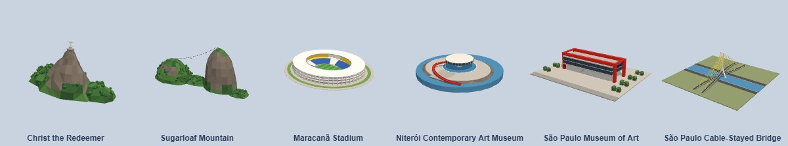

| Preview | Landmark | City / State | Description | Triangles | Size (W × H × D) | File |
|---|---|---|---|---|---|---|
| 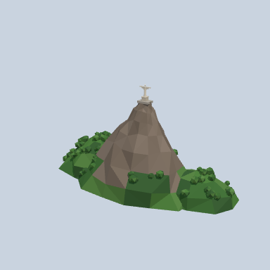 | **Christ the Redeemer**<br>Cristo Redentor<br>[`cristo_redentor.glb`](modelos/cristo_redentor.glb) | Rio de Janeiro, RJ | Open-armed statue on top of Corcovado hill, with its pedestal, the viewing terrace and the forested hill | 2,018 | 383 × 195 × 163 m | 215.8 KB |
|  | **Sugarloaf Mountain**<br>Pão de Açúcar<br>[`pao_de_acucar.glb`](modelos/pao_de_acucar.glb) | Rio de Janeiro, RJ | Sugarloaf and Urca hills with forest, both cable car stations and the cabin hanging on the cable | 3,898 | 1,105 × 406 × 365 m | 424.9 KB |
|  | **Maracanã Stadium**<br>Maracanã<br>[`maracana.glb`](modelos/maracana.glb) | Rio de Janeiro, RJ | Low elliptical bowl with the open facade of slanted pillars, ring beams, white roof, blue and yellow stands and the striped pitch | 3,920 | 380 × 35.4 × 336 m | 269.4 KB |
| 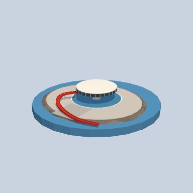 | **Niterói Contemporary Art Museum**<br>MAC Niterói<br>[`mac_niteroi.glb`](modelos/mac_niteroi.glb) | Niterói, RJ | The white saucer on its central column, the window band, the reflecting pool, the curving red ramp and the rocky lookout over the sea | 2,444 | 156 × 28.6 × 156 m | 177.8 KB |
| 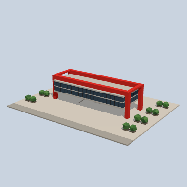 | **São Paulo Museum of Art**<br>MASP<br>[`masp.glb`](modelos/masp.glb) | São Paulo, SP | Glass box hung from the red portal frames over the open span, with the belvedere and its trees | 1,512 | 124 × 24.1 × 92.0 m | 127.1 KB |
| 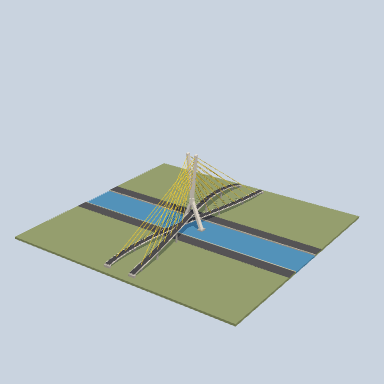 | **São Paulo Cable-Stayed Bridge**<br>Ponte Estaiada<br>[`ponte_estaiada.glb`](modelos/ponte_estaiada.glb) | São Paulo, SP | 138 m X-shaped pylon with fans of stay cables and two curved decks crossing at different levels over the river and its riverside roads | 1,584 | 460 × 144 × 430 m | 128.3 KB |

## South

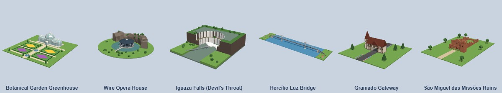

| Preview | Landmark | City / State | Description | Triangles | Size (W × H × D) | File |
|---|---|---|---|---|---|---|
| 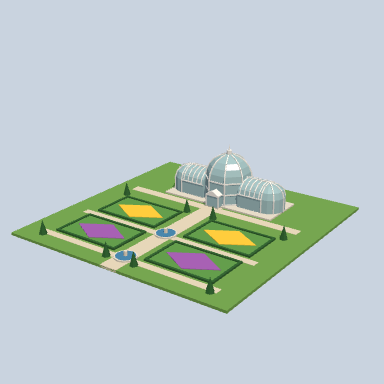 | **Botanical Garden Greenhouse**<br>Estufa do Jardim Botânico<br>[`estufa_jardim_botanico.glb`](modelos/estufa_jardim_botanico.glb) | Curitiba, PR | Iron-and-glass greenhouse with a central dome and two vaulted wings, and the formal garden with flower beds, fountains and clipped conifers | 3,260 | 92.0 × 24.1 × 94.0 m | 249.9 KB |
| 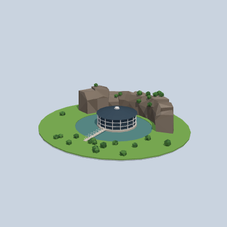 | **Wire Opera House**<br>Ópera de Arame<br>[`opera_de_arame.glb`](modelos/opera_de_arame.glb) | Curitiba, PR | Round theatre of white steel tubes with a transparent roof on a lake, with the tubular footbridge, the old quarry wall and the forest | 2,648 | 156 × 31.7 × 144 m | 222.3 KB |
| 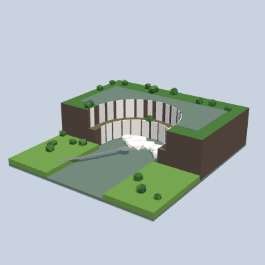 | **Iguazu Falls (Devil's Throat)**<br>Cataratas do Iguaçu (Garganta do Diabo)<br>[`cataratas_do_iguacu.glb`](modelos/cataratas_do_iguacu.glb) | Foz do Iguaçu, PR | U-shaped stepped basalt cliffs with many waterfalls, the cloud of spray, the metal walkway over the river and the forest on the banks | 1,620 | 132 × 41.1 × 140 m | 147.0 KB |
| 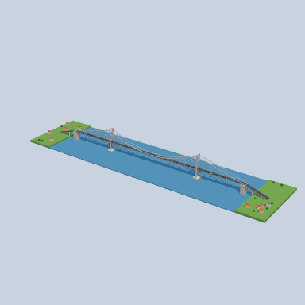 | **Hercílio Luz Bridge**<br>Ponte Hercílio Luz<br>[`ponte_hercilio_luz.glb`](modelos/ponte_hercilio_luz.glb) | Florianópolis, SC | Steel suspension bridge with two H-shaped towers, the eyebar chains that turn into a truss and the straight deck over the channel (820 m end to end) | 2,724 | 900 × 83.0 × 220 m | 221.3 KB |
| 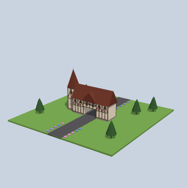 | **Gramado Gateway**<br>Pórtico de Gramado<br>[`portico_gramado.glb`](modelos/portico_gramado.glb) | Gramado, RS | Half-timbered gateway over the avenue, with the steep roof, dark beams on light walls, the pointed tower, window boxes and hydrangeas | 2,366 | 84.0 × 32.8 × 84.0 m | 197.1 KB |
|  | **São Miguel das Missões Ruins**<br>Ruínas de São Miguel das Missões<br>[`sao_miguel_das_missoes.glb`](modelos/sao_miguel_das_missoes.glb) | São Miguel das Missões, RS | Red sandstone church facade with the five-arch portico, the pediment and the ruined bell tower, the remains of the nave walls and the open field | 1,620 | 96.0 × 27.5 × 126 m | 122.8 KB |

## Central-West

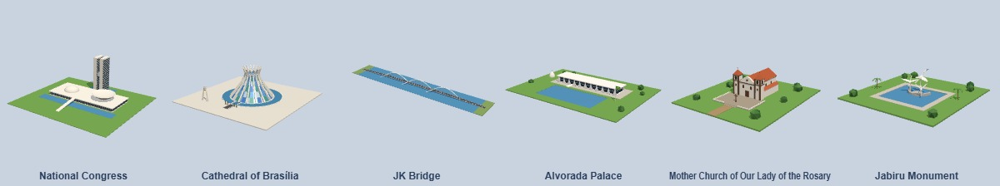

| Preview | Landmark | City / State | Description | Triangles | Size (W × H × D) | File |
|---|---|---|---|---|---|---|
| 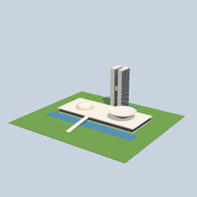 | **National Congress**<br>Congresso Nacional<br>[`congresso_nacional.glb`](modelos/congresso_nacional.glb) | Brasília, DF | Twin H-shaped towers, the Senate dome, the upturned bowl of the Chamber, the long platform, the ramp and the reflecting pools | 2,756 | 300 × 101 × 260 m | 196.6 KB |
| 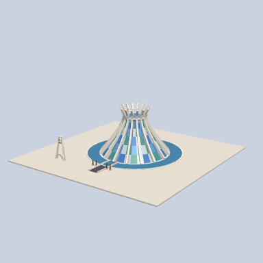 | **Cathedral of Brasília**<br>Catedral de Brasília<br>[`catedral_brasilia.glb`](modelos/catedral_brasilia.glb) | Brasília, DF | 16 curved concrete columns forming a hyperboloid, blue, green and white stained glass, the reflecting pool, the bell tower and the four evangelists | 3,322 | 150 × 43.1 × 150 m | 249.1 KB |
| 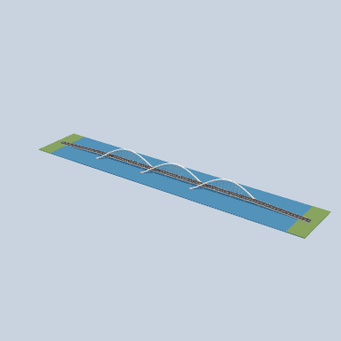 | **JK Bridge**<br>Ponte JK<br>[`ponte_jk.glb`](modelos/ponte_jk.glb) | Brasília, DF | Three asymmetric steel arches crossing the deck diagonally, the hangers, the piers and the lake (1.2 km end to end) | 3,056 | 1,260 × 65.8 × 220 m | 227.7 KB |
| 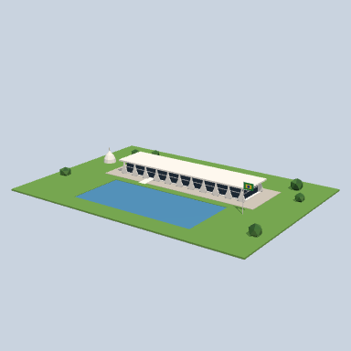 | **Alvorada Palace**<br>Palácio da Alvorada<br>[`palacio_da_alvorada.glb`](modelos/palacio_da_alvorada.glb) | Brasília, DF | Low glass box under the white roof slab, the colonnade of curved columns that touch the ground at a single point, the reflecting pool, the ramp and the chapel | 3,194 | 190 × 23.4 × 135 m | 215.6 KB |
| 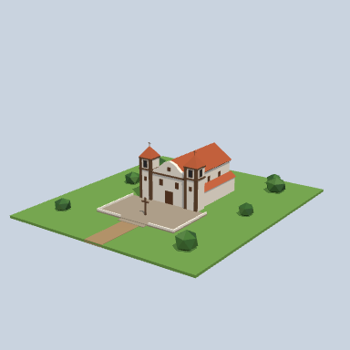 | **Mother Church of Our Lady of the Rosary**<br>Igreja Matriz de Nossa Senhora do Rosário<br>[`igreja_pirenopolis.glb`](modelos/igreja_pirenopolis.glb) | Pirenópolis, GO | Whitewashed colonial church with dark corner pilasters and frames, clay tile roof, two square bell towers, the stone forecourt and the wayside cross | 908 | 84.0 × 24.4 × 96.0 m | 75.2 KB |
| 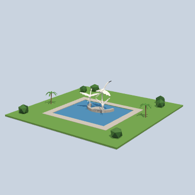 | **Jabiru Monument**<br>Monumento aos Tuiuiús<br>[`monumento_tuiuius.glb`](modelos/monumento_tuiuius.glb) | Campo Grande, MS | Three white metal jabiru storks in different stages of flight, wings open and necks stretched, on the curved concrete base in a reflecting pool | 1,260 | 92.0 × 21.3 × 92.0 m | 103.4 KB |

## Northeast


| Preview | Landmark | City / State | Description | Triangles | Size (W × H × D) | File |
|---|---|---|---|---|---|---|
| 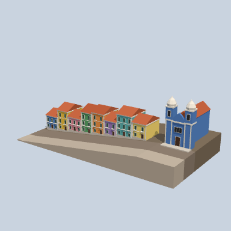 | **Pelourinho**<br>[`pelourinho.glb`](modelos/pelourinho.glb) | Salvador, BA | Sloping street of colourful colonial townhouses with balconies and tiled roofs, and the blue church at the top | 2,564 | 92.0 × 32.1 × 48.0 m | 196.4 KB |
| 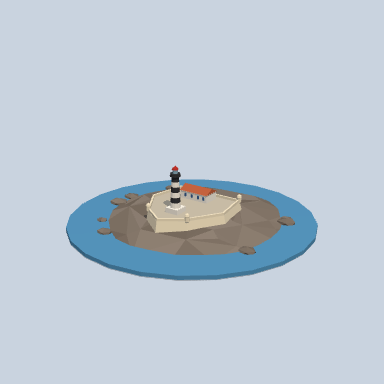 | **Barra Lighthouse**<br>Farol da Barra<br>[`farol_da_barra.glb`](modelos/farol_da_barra.glb) | Salvador, BA | Stone fort with sentry boxes on a rocky point, the keeper's house and the black-and-white striped lighthouse | 1,136 | 128 × 35.8 × 128 m | 93.3 KB |
| 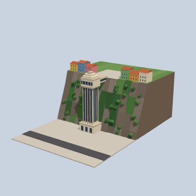 | **Lacerda Elevator**<br>Elevador Lacerda<br>[`elevador_lacerda.glb`](modelos/elevador_lacerda.glb) | Salvador, BA | 72 m art deco tower at the foot of the escarpment, the footbridge to the Upper Town, the houses along the top and the Lower Town square | 2,664 | 120 × 77.4 × 180 m | 234.3 KB |
|  | **Two Brothers Hills**<br>Morro Dois Irmãos<br>[`morro_dois_irmaos.glb`](modelos/morro_dois_irmaos.glb) | Fernando de Noronha, PE | Twin rock hills rising from the sea, with forest on top and rocks at the waterline | 1,620 | 160 × 52.8 × 160 m | 174.9 KB |
| 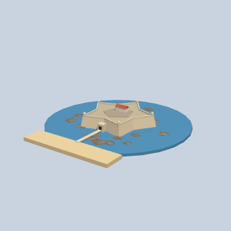 | **Fort of the Three Kings**<br>Forte dos Reis Magos<br>[`forte_reis_magos.glb`](modelos/forte_reis_magos.glb) | Natal, RN | Light stone fort shaped as a five-pointed star, with sloping walls, sentry boxes on the points, the courtyard, the gate and the causeway, on the reefs in the sea | 1,224 | 124 × 19.5 × 132 m | 108.8 KB |
| 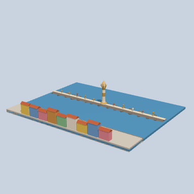 | **Francisco Brennand Sculpture Park**<br>Parque das Esculturas Francisco Brennand<br>[`parque_esculturas_brennand.glb`](modelos/parque_esculturas_brennand.glb) | Recife, PE | The Crystal Tower in ceramic and golden bronze on the stone breakwater in the sea, the smaller sculptures, the Marco Zero compass rose and the old Recife waterfront houses | 3,054 | 180 × 36.6 × 142 m | 262.0 KB |
| 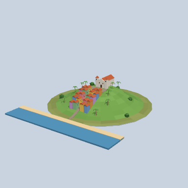 | **Alto da Sé, Olinda**<br>[`olinda_alto_da_se.glb`](modelos/olinda_alto_da_se.glb) | Olinda, PE | Hilltop with the white two-tower cathedral, colourful colonial houses on both sides of the cobbled slope, coconut palms and the beach below | 3,610 | 190 × 46.9 × 204 m | 292.5 KB |

## North

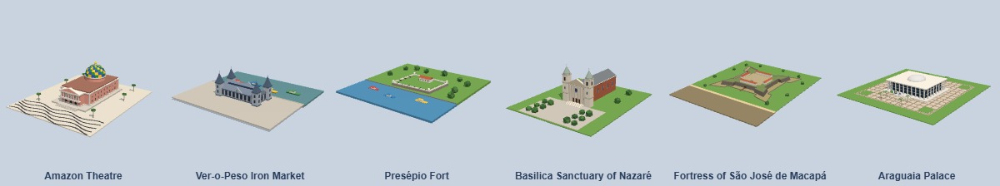

| Preview | Landmark | City / State | Description | Triangles | Size (W × H × D) | File |
|---|---|---|---|---|---|---|
| 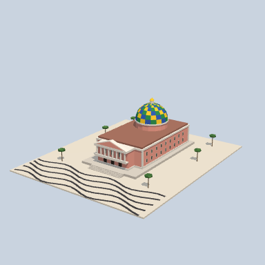 | **Amazon Theatre**<br>Teatro Amazonas<br>[`teatro_amazonas.glb`](modelos/teatro_amazonas.glb) | Manaus, AM | Pink opera house with white colonnade and pediment, the green, yellow and blue mosaic dome and the square with its wave-patterned pavement | 3,278 | 120 × 43.7 × 145 m | 251.1 KB |
| 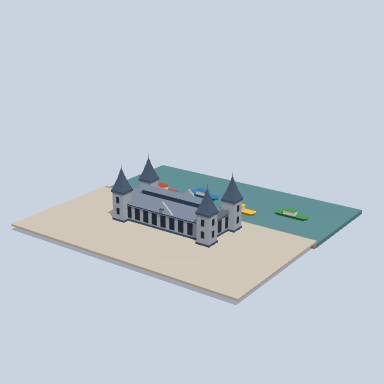 | **Ver-o-Peso Iron Market**<br>Ver-o-Peso<br>[`ver_o_peso.glb`](modelos/ver_o_peso.glb) | Belém, PA | Bluish-grey iron market hall with four pointed corner turrets, the roof with its clerestory, the quay and colourful boats on the river | 1,652 | 124 × 30.8 × 115 m | 127.4 KB |
| 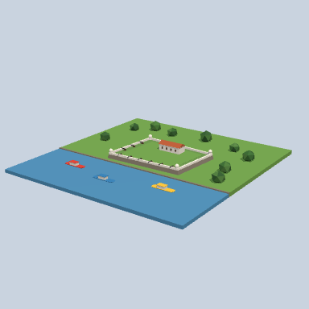 | **Presépio Fort**<br>Forte do Presépio<br>[`forte_do_presepio.glb`](modelos/forte_do_presepio.glb) | Belém, PA | Low stone walls with a white parapet on the bay, sentry boxes at the corners, cannons facing the water, the grassy courtyard and regional boats | 980 | 150 × 13.2 × 155 m | 83.2 KB |
| 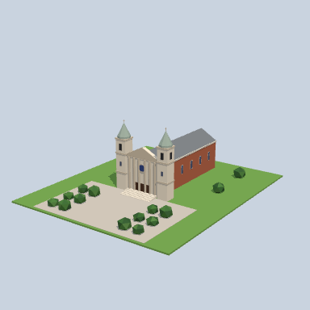 | **Basilica Sanctuary of Nazaré**<br>Basílica Santuário de Nazaré<br>[`basilica_nazare.glb`](modelos/basilica_nazare.glb) | Belém, PA | Neoclassical church with the marble facade, brick side walls, two bell towers, the pediment, the rose window, the front steps and the tree-lined square | 1,512 | 124 × 49.7 × 148 m | 124.9 KB |
| 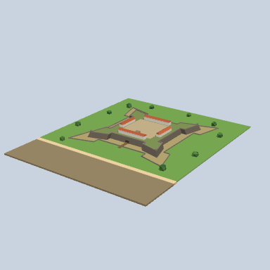 | **Fortress of São José de Macapá**<br>Fortaleza de São José de Macapá<br>[`fortaleza_macapa.glb`](modelos/fortaleza_macapa.glb) | Macapá, AP | Square dark stone fortress with four pentagonal bastions, the moat, sentry boxes, the gate bridge, white barracks and the Amazon River | 1,232 | 270 × 20.6 × 330 m | 99.1 KB |
| 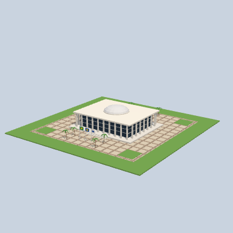 | **Araguaia Palace**<br>Palácio Araguaia<br>[`palacio_araguaia.glb`](modelos/palacio_araguaia.glb) | Palmas, TO | Modernist seat of government with a glass facade, monumental white columns under the roof slab, the low dome, the flagpoles and the geometric square with palm trees | 2,514 | 184 × 27.3 × 184 m | 202.6 KB |

## Folders

- `modelos/<id>.glb`: one landmark per file.
- `previas/<id>.png`: three-quarter view of each model from the front.
- `catalogo.json`: every model with Portuguese and English names, city, state, region, description, size, triangles and file paths.
- `docs/`: the full mosaic, one mosaic per region and the cover.

## How to use

- **Units and axes:** meters at approximate real-world scale, Y up, front facing +Z. The origin is the center of the base with ground level at Y = 0; the ground slab sinks about 1 m and sea or river water sits below 0, so you can drop a model on flat terrain at Y = 0.
- **Colors:** all color is in the vertex colors (attribute `COLOR_0`). Most glTF importers turn them on automatically; if a model looks white, enable vertex colors in its material.
- **Big models:** the bridges, the falls and the hills are large (the JK Bridge is 1.26 km long and the Hercílio Luz Bridge 820 m). Scale them down for a diorama or keep them at 1:1 as background landmarks.
- **Web (JavaScript WebGL libraries):** load the `.glb` with the library's glTF loader and add the scene; set `material.vertexColors = true` if needed.
- **Open-source and commercial game engines:** drag the `.glb` into the project (or use the engine's glTF importer package); each file imports as one mesh with two materials.
- **3D editors:** File › Import › glTF 2.0. The vertex color layer is called `Color`.

```js
const cathedral = (await gltfLoader.loadAsync("modelos/catedral_brasilia.glb")).scene;
cathedral.traverse((o) => { if (o.isMesh) o.material.vertexColors = true; });
scene.add(cathedral);
```

## FAQ

**Can I use these models in a commercial game?**
Yes. They are public domain (CC0 1.0): use, modify and redistribute them without asking and without credit. Credit is welcome (see [`CITATION.cff`](CITATION.cff)).

**Are they exact replicas?**
No. They are low poly interpretations at approximate real scale, built to be recognizable from a distance: silhouettes, proportions and colors follow the real landmarks, details are simplified.

**How were they made?**
By code: each landmark is assembled from boxes, beams, lathe and loft surfaces and convex hulls with vertex colors in a Python script, then exported, loaded back and rendered to check it. Every mesh is a set of closed shells with outward normals.

## Versions

- **2 (November 26, 2026):** 14 more landmarks, now at least six per region; the pack is now called Brazil Landmarks Low Poly.
- **1:** first release, with 17 landmarks.

## More free packs from the same game

- [Rally car fleet](https://github.com/kayquer/scitizia-frota-64) · [Breakable props](https://github.com/kayquer/scitizia-props-64) · [People](https://github.com/kayquer/scitizia-pessoas-64) · [Wheels and tyres](https://github.com/kayquer/scitizia-rodas-64) · [Car parts](https://github.com/kayquer/scitizia-pecas-64) · [Town](https://github.com/kayquer/scitizia-cidade-64) · [Nature](https://github.com/kayquer/scitizia-natureza-64)

## License

[CC0 1.0 Universal](LICENSE): public domain dedication by Kayque Rotondo.

## How to cite

Citation metadata is in [`CITATION.cff`](CITATION.cff).
