# Brazil Landmarks Low Poly: 31 monumentos brasileiros low poly em glTF/GLB (CC0)

🇧🇷 Português · **🇬🇧 [Read in English](README.md)**

![Mosaico com os 31 monumentos brasileiros low poly: Cristo Redentor, Pão de Açúcar, Maracanã, MAC Niterói, MASP, Ponte Estaiada, Estufa do Jardim Botânico, Ópera de Arame, Cataratas do Iguaçu (Garganta do Diabo), Ponte Hercílio Luz, Pórtico de Gramado, Ruínas de São Miguel das Missões, Congresso Nacional, Catedral de Brasília, Ponte JK, Palácio da Alvorada, Igreja Matriz de Nossa Senhora do Rosário, Monumento aos Tuiuiús, Pelourinho, Farol da Barra, Elevador Lacerda, Morro Dois Irmãos, Forte dos Reis Magos, Parque das Esculturas Francisco Brennand, Alto da Sé, Olinda, Teatro Amazonas, Ver-o-Peso, Forte do Presépio, Basílica Santuário de Nazaré, Fortaleza de São José de Macapá e Palácio Araguaia](docs/landmarks-low-poly-64.jpg)

**Brazil Landmarks Low Poly** é uma coleção gratuita de **31 monumentos e cartões-postais do Brasil** em baixo polígono (low poly), com o visual retrô dos consoles de 64 bits, pelo menos seis de cada uma das cinco regiões do país: Cristo Redentor, Pão de Açúcar, Cataratas do Iguaçu, Ponte Hercílio Luz, Congresso Nacional, Palácio da Alvorada, Pelourinho, Olinda, Teatro Amazonas e Fortaleza de São José de Macapá, entre outros. Cada um é um único arquivo glTF 2.0 binário (`.glb`, de 908 a 3.920 triângulos), em escala real aproximada, com faces chapadas, cor por vértice e sem texturas, pronto para jogos em tempo real, mapas, dioramas e cenários de fundo. Foram feitos para o trailer de abertura e o mundo do jogo de rali de navegador **Kaltror Rally**. Domínio público (CC0 1.0).

**Novo na versão 2:** mais 14 monumentos (Ópera de Arame, Cataratas do Iguaçu (Garganta do Diabo), Ponte Hercílio Luz, Pórtico de Gramado, Palácio da Alvorada, Igreja Matriz de Nossa Senhora do Rosário, Monumento aos Tuiuiús, Forte dos Reis Magos, Parque das Esculturas Francisco Brennand, Alto da Sé, Olinda, Forte do Presépio, Basílica Santuário de Nazaré, Fortaleza de São José de Macapá e Palácio Araguaia). O pacote se chamava Scitizia Landmarks 64; os nomes e os caminhos dos arquivos não mudaram.

## Em resumo

| | |
|---|---|
| Modelos | 31: Sudeste (6) · Sul (6) · Centro-Oeste (6) · Nordeste (7) · Norte (6) |
| Formato | glTF 2.0 binário (`.glb`), um objeto por arquivo |
| Triângulos | de 908 a 3.920 por modelo (média de 2.295) |
| Tamanho do arquivo | de 75,2 a 424,9 KB |
| Materiais | `liso` (cor por vértice, rugosidade 0,92) e `vidro` (vidro, cor por vértice, rugosidade 0,3); sem texturas |
| Escala e eixos | metros do mundo real (aproximados), Y para cima, frente voltada para +Z, origem no centro da base com o nível do chão em Y = 0 |
| Catálogo para programas | [`catalogo.json`](catalogo.json) |
| Autor | Kayque Rotondo |
| Licença | domínio público, [CC0 1.0](LICENSE) |

## Sudeste

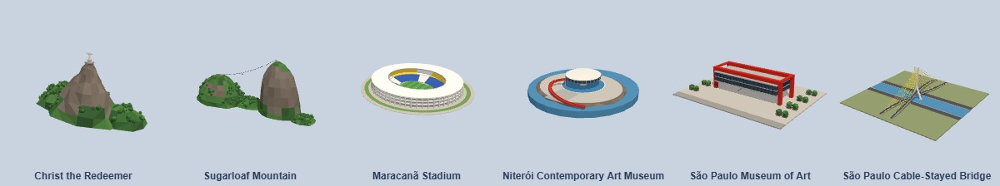

| Prévia | Monumento | Cidade / UF | Descrição | Triângulos | Medidas (L × A × P) | Arquivo |
|---|---|---|---|---|---|---|
| 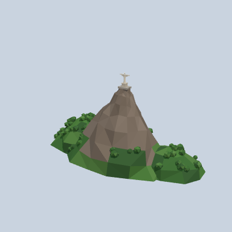 | **Cristo Redentor**<br>Christ the Redeemer<br>[`cristo_redentor.glb`](modelos/cristo_redentor.glb) | Rio de Janeiro, RJ | Estátua de braços abertos no alto do Corcovado, com o pedestal, o terraço do mirante e o morro coberto de mata | 2.018 | 383 × 195 × 163 m | 215,8 KB |
|  | **Pão de Açúcar**<br>Sugarloaf Mountain<br>[`pao_de_acucar.glb`](modelos/pao_de_acucar.glb) | Rio de Janeiro, RJ | Os morros do Pão de Açúcar e da Urca com mata, as duas estações e a cabine do bondinho no cabo | 3.898 | 1.105 × 406 × 365 m | 424,9 KB |
|  | **Maracanã**<br>Maracanã Stadium<br>[`maracana.glb`](modelos/maracana.glb) | Rio de Janeiro, RJ | Anel elíptico baixo com a fachada vazada de pilares, as cintas, a cobertura branca, a arquibancada azul e amarela e o gramado listrado | 3.920 | 380 × 35,4 × 336 m | 269,4 KB |
|  | **MAC Niterói**<br>Niterói Contemporary Art Museum<br>[`mac_niteroi.glb`](modelos/mac_niteroi.glb) | Niterói, RJ | O cálice branco sobre o pilar central, a faixa de janelas, o espelho d'água, a rampa vermelha em curva e o mirante de pedra sobre o mar | 2.444 | 156 × 28,6 × 156 m | 177,8 KB |
| 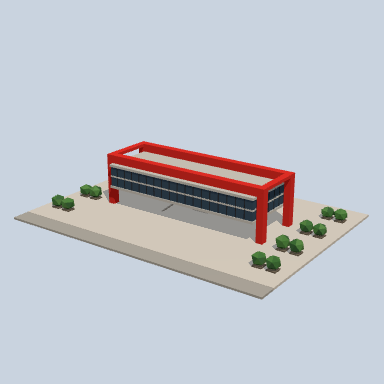 | **MASP**<br>São Paulo Museum of Art<br>[`masp.glb`](modelos/masp.glb) | São Paulo, SP | Caixa de vidro suspensa pelos pórticos vermelhos sobre o vão livre, com o belvedere e as árvores | 1.512 | 124 × 24,1 × 92,0 m | 127,1 KB |
|  | **Ponte Estaiada**<br>São Paulo Cable-Stayed Bridge<br>[`ponte_estaiada.glb`](modelos/ponte_estaiada.glb) | São Paulo, SP | Mastro em X de 138 m com os estais em leque e as duas pistas curvas que se cruzam em níveis diferentes sobre o rio e as marginais | 1.584 | 460 × 144 × 430 m | 128,3 KB |

## Sul


| Prévia | Monumento | Cidade / UF | Descrição | Triângulos | Medidas (L × A × P) | Arquivo |
|---|---|---|---|---|---|---|
|  | **Estufa do Jardim Botânico**<br>Botanical Garden Greenhouse<br>[`estufa_jardim_botanico.glb`](modelos/estufa_jardim_botanico.glb) | Curitiba, PR | Estufa de ferro e vidro com a cúpula central e as duas alas em abóbada, e o jardim geométrico com canteiros, chafarizes e ciprestes | 3.260 | 92,0 × 24,1 × 94,0 m | 249,9 KB |
| 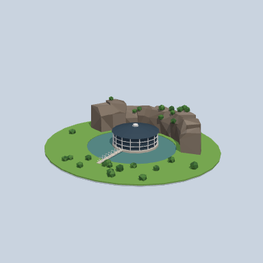 | **Ópera de Arame**<br>Wire Opera House<br>[`opera_de_arame.glb`](modelos/opera_de_arame.glb) | Curitiba, PR | Teatro circular de tubos de aço brancos e cúpula transparente sobre um lago, com a passarela tubular, o paredão da antiga pedreira e a mata | 2.648 | 156 × 31,7 × 144 m | 222,3 KB |
|  | **Cataratas do Iguaçu (Garganta do Diabo)**<br>Iguazu Falls (Devil's Throat)<br>[`cataratas_do_iguacu.glb`](modelos/cataratas_do_iguacu.glb) | Foz do Iguaçu, PR | Paredões de basalto em degraus, em forma de U, com várias quedas d'água, a nuvem de espuma, a passarela metálica sobre o rio e a mata nas margens | 1.620 | 132 × 41,1 × 140 m | 147,0 KB |
|  | **Ponte Hercílio Luz**<br>Hercílio Luz Bridge<br>[`ponte_hercilio_luz.glb`](modelos/ponte_hercilio_luz.glb) | Florianópolis, SC | Ponte pênsil de aço com as duas torres em H, as correntes de barras de olhal que viram treliça e o tabuleiro reto sobre o canal (820 m de ponta a ponta) | 2.724 | 900 × 83,0 × 220 m | 221,3 KB |
|  | **Pórtico de Gramado**<br>Gramado Gateway<br>[`portico_gramado.glb`](modelos/portico_gramado.glb) | Gramado, RS | Portal em enxaimel sobre a avenida, com o telhado muito inclinado, as vigas escuras sobre paredes claras, a torre pontiaguda, floreiras e hortênsias | 2.366 | 84,0 × 32,8 × 84,0 m | 197,1 KB |
|  | **Ruínas de São Miguel das Missões**<br>São Miguel das Missões Ruins<br>[`sao_miguel_das_missoes.glb`](modelos/sao_miguel_das_missoes.glb) | São Miguel das Missões, RS | Fachada da igreja em arenito avermelhado com o pórtico de cinco arcos, o frontão e a torre sineira em ruína, as paredes da nave e o campo aberto | 1.620 | 96,0 × 27,5 × 126 m | 122,8 KB |

## Centro-Oeste


| Prévia | Monumento | Cidade / UF | Descrição | Triângulos | Medidas (L × A × P) | Arquivo |
|---|---|---|---|---|---|---|
| 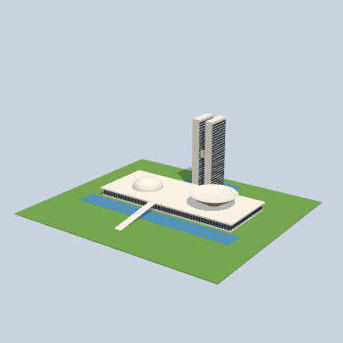 | **Congresso Nacional**<br>National Congress<br>[`congresso_nacional.glb`](modelos/congresso_nacional.glb) | Brasília, DF | As duas torres em H, a cúpula do Senado, a cuba da Câmara, a laje longa, a rampa e os espelhos d'água | 2.756 | 300 × 101 × 260 m | 196,6 KB |
| 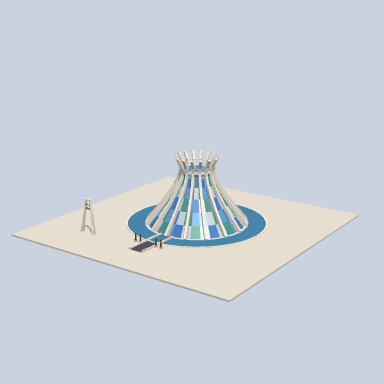 | **Catedral de Brasília**<br>Cathedral of Brasília<br>[`catedral_brasilia.glb`](modelos/catedral_brasilia.glb) | Brasília, DF | As 16 colunas curvas de concreto em hiperboloide, os vitrais azuis, verdes e brancos, o espelho d'água, o campanário e os quatro evangelistas | 3.322 | 150 × 43,1 × 150 m | 249,1 KB |
|  | **Ponte JK**<br>JK Bridge<br>[`ponte_jk.glb`](modelos/ponte_jk.glb) | Brasília, DF | Três arcos de aço assimétricos que cruzam o tabuleiro em diagonal, os pendurais, os pilares e o lago (1,2 km de ponta a ponta) | 3.056 | 1.260 × 65,8 × 220 m | 227,7 KB |
|  | **Palácio da Alvorada**<br>Alvorada Palace<br>[`palacio_da_alvorada.glb`](modelos/palacio_da_alvorada.glb) | Brasília, DF | Caixa de vidro baixa sob a laje branca, a colunata de colunas curvas que só tocam o chão num ponto, o espelho d'água, a rampa e a capela | 3.194 | 190 × 23,4 × 135 m | 215,6 KB |
| 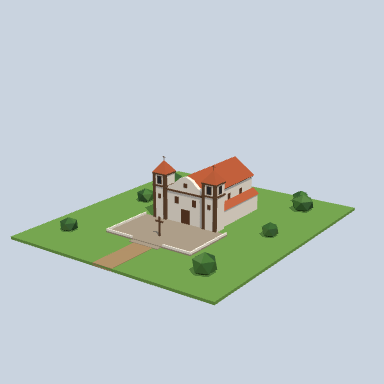 | **Igreja Matriz de Nossa Senhora do Rosário**<br>Mother Church of Our Lady of the Rosary<br>[`igreja_pirenopolis.glb`](modelos/igreja_pirenopolis.glb) | Pirenópolis, GO | Igreja colonial caiada de branco com cunhais e molduras escuras, telhado de barro, duas torres sineiras quadradas, o adro de pedra e o cruzeiro | 908 | 84,0 × 24,4 × 96,0 m | 75,2 KB |
|  | **Monumento aos Tuiuiús**<br>Jabiru Monument<br>[`monumento_tuiuius.glb`](modelos/monumento_tuiuius.glb) | Campo Grande, MS | Três tuiuiús de metal branco em fases do voo, de asas abertas e pescoço comprido, sobre a base curva de concreto no meio do espelho d'água | 1.260 | 92,0 × 21,3 × 92,0 m | 103,4 KB |

## Nordeste


| Prévia | Monumento | Cidade / UF | Descrição | Triângulos | Medidas (L × A × P) | Arquivo |
|---|---|---|---|---|---|---|
| 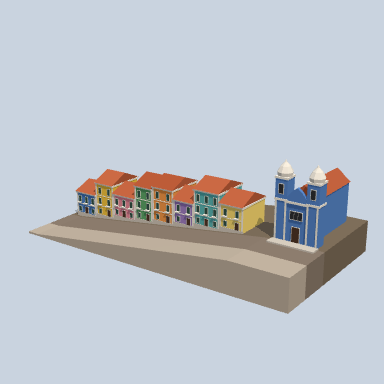 | **Pelourinho**<br>[`pelourinho.glb`](modelos/pelourinho.glb) | Salvador, BA | Ladeira de casarões coloniais coloridos com sacadas e telhados de telha, e a igreja azul no alto | 2.564 | 92,0 × 32,1 × 48,0 m | 196,4 KB |
|  | **Farol da Barra**<br>Barra Lighthouse<br>[`farol_da_barra.glb`](modelos/farol_da_barra.glb) | Salvador, BA | Forte de pedra com guaritas sobre a ponta de rocha, a casa do faroleiro e o farol listrado em preto e branco | 1.136 | 128 × 35,8 × 128 m | 93,3 KB |
| 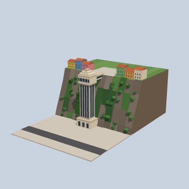 | **Elevador Lacerda**<br>Lacerda Elevator<br>[`elevador_lacerda.glb`](modelos/elevador_lacerda.glb) | Salvador, BA | Torre art déco de 72 m ao pé da falésia, a passarela até a Cidade Alta, o casario no alto e a praça da Cidade Baixa | 2.664 | 120 × 77,4 × 180 m | 234,3 KB |
|  | **Morro Dois Irmãos**<br>Two Brothers Hills<br>[`morro_dois_irmaos.glb`](modelos/morro_dois_irmaos.glb) | Fernando de Noronha, PE | As duas formações rochosas gêmeas saindo do mar, com mata no alto e pedras na linha d'água | 1.620 | 160 × 52,8 × 160 m | 174,9 KB |
| 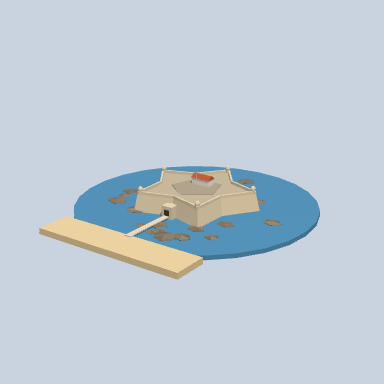 | **Forte dos Reis Magos**<br>Fort of the Three Kings<br>[`forte_reis_magos.glb`](modelos/forte_reis_magos.glb) | Natal, RN | Fortaleza de pedra clara em estrela de cinco pontas, com muralhas inclinadas, guaritas nas pontas, o pátio, o portão e a ponte, sobre os recifes no mar | 1.224 | 124 × 19,5 × 132 m | 108,8 KB |
|  | **Parque das Esculturas Francisco Brennand**<br>Francisco Brennand Sculpture Park<br>[`parque_esculturas_brennand.glb`](modelos/parque_esculturas_brennand.glb) | Recife, PE | A Torre de Cristal de cerâmica e bronze dourado no molhe de pedras no meio do mar, as esculturas menores, a rosa dos ventos do Marco Zero e o casario do Recife Antigo | 3.054 | 180 × 36,6 × 142 m | 262,0 KB |
|  | **Alto da Sé, Olinda**<br>[`olinda_alto_da_se.glb`](modelos/olinda_alto_da_se.glb) | Olinda, PE | Colina com a Sé branca de duas torres, o casario colonial colorido dos dois lados da ladeira de paralelepípedo, coqueiros e a praia lá embaixo | 3.610 | 190 × 46,9 × 204 m | 292,5 KB |

## Norte


| Prévia | Monumento | Cidade / UF | Descrição | Triângulos | Medidas (L × A × P) | Arquivo |
|---|---|---|---|---|---|---|
|  | **Teatro Amazonas**<br>Amazon Theatre<br>[`teatro_amazonas.glb`](modelos/teatro_amazonas.glb) | Manaus, AM | Teatro rosa com colunata e frontão brancos, a cúpula de mosaico verde, amarelo e azul e a praça com ondas de pedra portuguesa | 3.278 | 120 × 43,7 × 145 m | 251,1 KB |
| 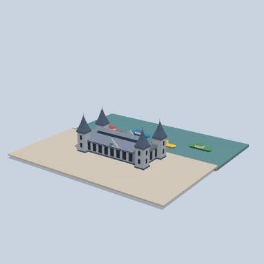 | **Ver-o-Peso**<br>Ver-o-Peso Iron Market<br>[`ver_o_peso.glb`](modelos/ver_o_peso.glb) | Belém, PA | Mercado de ferro cinza-azulado com as quatro torres de coruchéu pontiagudo, o telhado com lanternim, o cais e barcos coloridos no rio | 1.652 | 124 × 30,8 × 115 m | 127,4 KB |
|  | **Forte do Presépio**<br>Presépio Fort<br>[`forte_do_presepio.glb`](modelos/forte_do_presepio.glb) | Belém, PA | Muralhas baixas de pedra com parapeito branco à beira da baía, guaritas nos cantos, canhões voltados para a água, o pátio gramado e barcos regionais | 980 | 150 × 13,2 × 155 m | 83,2 KB |
|  | **Basílica Santuário de Nazaré**<br>Basilica Sanctuary of Nazaré<br>[`basilica_nazare.glb`](modelos/basilica_nazare.glb) | Belém, PA | Igreja neoclássica com a fachada de mármore, as laterais de tijolo, duas torres sineiras, o frontão, a rosácea, a escadaria e a praça arborizada | 1.512 | 124 × 49,7 × 148 m | 124,9 KB |
|  | **Fortaleza de São José de Macapá**<br>Fortress of São José de Macapá<br>[`fortaleza_macapa.glb`](modelos/fortaleza_macapa.glb) | Macapá, AP | Forte quadrado de pedra escura com quatro baluartes pentagonais, o fosso, as guaritas, a ponte do portão, os quartéis brancos e o Rio Amazonas | 1.232 | 270 × 20,6 × 330 m | 99,1 KB |
|  | **Palácio Araguaia**<br>Araguaia Palace<br>[`palacio_araguaia.glb`](modelos/palacio_araguaia.glb) | Palmas, TO | Sede do governo modernista com fachada de vidro, colunas brancas monumentais sob a laje, a cúpula baixa, os mastros e a praça geométrica com palmeiras | 2.514 | 184 × 27,3 × 184 m | 202,6 KB |

## Pastas

- `modelos/<id>.glb`: um monumento por arquivo.
- `previas/<id>.png`: vista em três quartos de cada modelo, de frente.
- `catalogo.json`: todos os modelos com nomes em português e inglês, cidade, estado, região, descrição, medidas, triângulos e caminhos dos arquivos.
- `docs/`: o mosaico completo, um mosaico por região e a capa.

## Como usar

- **Unidades e eixos:** metros em escala real aproximada, Y para cima, frente voltada para +Z. A origem fica no centro da base, com o nível do chão em Y = 0; a laje do terreno afunda cerca de 1 m e a água do mar ou do rio fica abaixo de 0, então dá para pôr um modelo em terreno plano em Y = 0.
- **Cores:** toda a cor está na cor por vértice (atributo `COLOR_0`). A maioria dos importadores de glTF liga essa cor sozinha; se um modelo aparecer branco, ligue a cor por vértice no material.
- **Modelos grandes:** as pontes, as quedas e os morros são grandes (a Ponte JK tem 1,26 km e a Hercílio Luz, 820 m). Reduza a escala para um diorama ou mantenha em 1:1 como cenário de fundo.
- **Web (bibliotecas WebGL em JavaScript):** carregue o `.glb` com o carregador de glTF da biblioteca e adicione a cena; defina `material.vertexColors = true` se for preciso.
- **Motores de jogo de código aberto e comerciais:** arraste o `.glb` para o projeto (ou use o pacote de importação de glTF do motor); cada arquivo entra como uma malha com dois materiais.
- **Editores 3D:** Arquivo › Importar › glTF 2.0. A camada de cor por vértice se chama `Color`.

```js
const cathedral = (await gltfLoader.loadAsync("modelos/catedral_brasilia.glb")).scene;
cathedral.traverse((o) => { if (o.isMesh) o.material.vertexColors = true; });
scene.add(cathedral);
```

## Perguntas frequentes

**Posso usar esses modelos em um jogo comercial?**
Sim. Eles são de domínio público (CC0 1.0): use, modifique e redistribua sem pedir licença e sem dar crédito. O crédito é bem-vindo (veja [`CITATION.cff`](CITATION.cff)).

**São réplicas exatas?**
Não. São interpretações low poly em escala real aproximada, feitas para serem reconhecidas de longe: silhuetas, proporções e cores seguem os monumentos reais, e os detalhes são simplificados.

**Como foram feitos?**
Por código: cada monumento é montado com caixas, vigas, superfícies de revolução e de loft e envoltórias convexas com cor por vértice em um script Python, depois exportado, carregado de volta e renderizado para conferência. Cada malha é um conjunto de cascas fechadas com as normais para fora.

## Versões

- **2 (26/11/2026):** mais 14 monumentos, agora com pelo menos seis por região; o pacote passou a se chamar Brazil Landmarks Low Poly.
- **1:** primeira versão, com 17 monumentos.

## Mais pacotes gratuitos do mesmo jogo

- [Frota de carros de rali](https://github.com/kayquer/scitizia-frota-64) · [Objetos quebráveis](https://github.com/kayquer/scitizia-props-64) · [Pessoas](https://github.com/kayquer/scitizia-pessoas-64) · [Rodas e pneus](https://github.com/kayquer/scitizia-rodas-64) · [Peças de carro](https://github.com/kayquer/scitizia-pecas-64) · [Cidade](https://github.com/kayquer/scitizia-cidade-64) · [Natureza](https://github.com/kayquer/scitizia-natureza-64)

## Licença

[CC0 1.0 Universal](LICENSE): dedicação ao domínio público por Kayque Rotondo.

## Como citar

Os metadados de citação estão em [`CITATION.cff`](CITATION.cff).
