# Scitizia Monumentos 64: 17 monumentos brasileiros low poly em glTF/GLB (CC0)

🇧🇷 Português · **🇬🇧 [Read in English](README.md)**


**Scitizia Monumentos 64** é uma coleção gratuita de **17 monumentos famosos do Brasil** modelados em baixo polígono (low poly), com o visual retrô dos consoles de 64 bits, das cinco regiões do país: Cristo Redentor, Pão de Açúcar, Maracanã, o Museu de Arte Contemporânea de Niterói, o MASP, a ponte estaiada de São Paulo, a estufa do Jardim Botânico de Curitiba, as ruínas de São Miguel das Missões, o Congresso Nacional, a Catedral de Brasília, a Ponte JK, o Pelourinho, o Farol da Barra, o Elevador Lacerda, o Morro Dois Irmãos de Fernando de Noronha, o Teatro Amazonas e o mercado de ferro do Ver-o-Peso. Cada um é um único arquivo glTF 2.0 binário (`.glb`, de 1.136 a 3.920 triângulos), em escala real aproximada, com faces chapadas, cor por vértice e sem texturas, pronto para jogos em tempo real, mapas, dioramas e cenários de fundo. Foram feitos para o trailer de abertura e o mundo do jogo de rali de navegador **Kaltror Rally**. Domínio público (CC0 1.0).

## Em resumo

| | |
|---|---|
| Modelos | 17: Sudeste (6) · Sul (2) · Centro-Oeste (3) · Nordeste (4) · Norte (2) |
| Formato | glTF 2.0 binário (`.glb`), um objeto por arquivo |
| Triângulos | de 1.136 a 3.920 por modelo (média de 2.488) |
| Tamanho do arquivo | de 93,3 a 424,9 KB |
| Materiais | `liso` (cor por vértice, rugosidade 0,92) e `vidro` (vidro, cor por vértice, rugosidade 0,3); sem texturas |
| Escala e eixos | metros do mundo real (aproximados), Y para cima, frente voltada para +Z, origem no centro da base com o nível do chão em Y = 0 |
| Catálogo legível por máquina | [`catalogo.json`](catalogo.json) |
| Autor | Kayque Rotondo |
| Licença | domínio público, [CC0 1.0](LICENSE) |

## Sudeste


| Prévia | Monumento | Cidade / UF | Descrição | Triângulos | Medidas (L × A × P) | Arquivo |
|---|---|---|---|---|---|---|
|  | **Cristo Redentor**<br>[`cristo_redentor.glb`](modelos/cristo_redentor.glb) | Rio de Janeiro, RJ | Estátua de braços abertos no alto do Corcovado, com o pedestal, o terraço do mirante e o morro coberto de mata | 2.018 | 383 × 195 × 163 m | 215,8 KB |
| 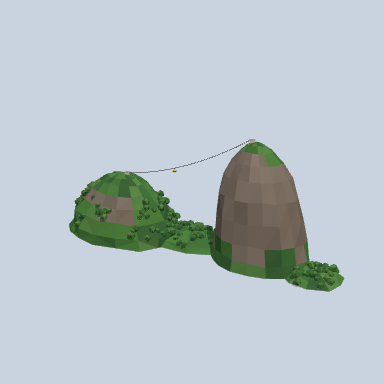 | **Pão de Açúcar**<br>[`pao_de_acucar.glb`](modelos/pao_de_acucar.glb) | Rio de Janeiro, RJ | Os morros do Pão de Açúcar e da Urca com mata, as duas estações do bondinho e a cabine pendurada no cabo | 3.898 | 1.105 × 406 × 365 m | 424,9 KB |
| 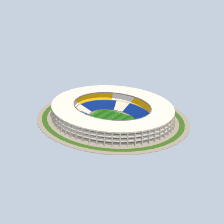 | **Maracanã**<br>[`maracana.glb`](modelos/maracana.glb) | Rio de Janeiro, RJ | Anel elíptico baixo com a fachada vazada de pilares inclinados, as cintas, a cobertura branca, as arquibancadas azul e amarela e o gramado listrado | 3.920 | 380 × 35,4 × 336 m | 269,4 KB |
| 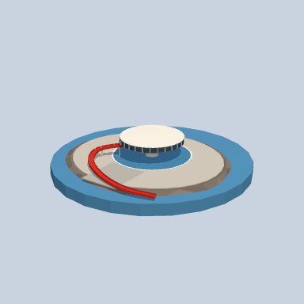 | **MAC Niterói**<br>[`mac_niteroi.glb`](modelos/mac_niteroi.glb) | Niterói, RJ | O disco branco sobre o pilar central, a faixa de janelas, o espelho d'água, a rampa vermelha em curva e o mirante de pedra sobre o mar | 2.444 | 156 × 28,6 × 156 m | 177,8 KB |
|  | **MASP**<br>[`masp.glb`](modelos/masp.glb) | São Paulo, SP | Caixa de vidro suspensa pelos pórticos vermelhos sobre o vão livre, com o belvedere e as árvores | 1.512 | 124 × 24,1 × 92,0 m | 127,1 KB |
| 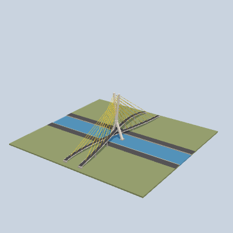 | **Ponte Estaiada**<br>[`ponte_estaiada.glb`](modelos/ponte_estaiada.glb) | São Paulo, SP | Mastro em X de 138 m com os estais em leque e as duas pistas curvas que se cruzam em níveis diferentes sobre o rio e as marginais | 1.584 | 460 × 144 × 430 m | 128,3 KB |

## Sul

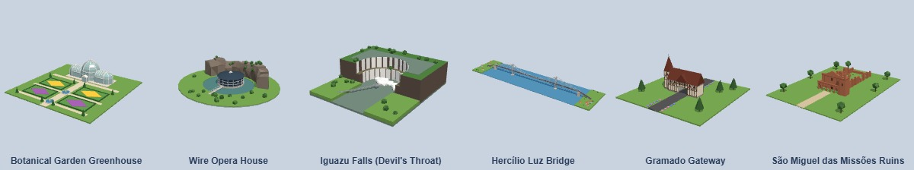

| Prévia | Monumento | Cidade / UF | Descrição | Triângulos | Medidas (L × A × P) | Arquivo |
|---|---|---|---|---|---|---|
| 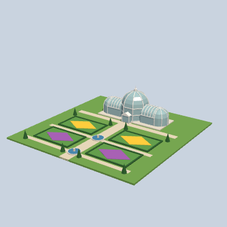 | **Estufa do Jardim Botânico de Curitiba**<br>[`estufa_jardim_botanico.glb`](modelos/estufa_jardim_botanico.glb) | Curitiba, PR | Estufa de ferro e vidro com a cúpula central e as duas alas em abóbada, e o jardim geométrico com canteiros, chafarizes e coníferas podadas | 3.260 | 92,0 × 24,1 × 94,0 m | 249,9 KB |
| 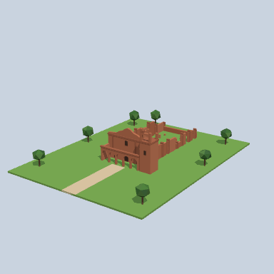 | **Ruínas de São Miguel das Missões**<br>[`sao_miguel_das_missoes.glb`](modelos/sao_miguel_das_missoes.glb) | São Miguel das Missões, RS | Fachada da igreja em arenito vermelho com o pórtico de cinco arcos, o frontão e a torre sineira em ruína, os restos das paredes da nave e o campo aberto | 1.620 | 96,0 × 27,5 × 126 m | 122,8 KB |

## Centro-Oeste

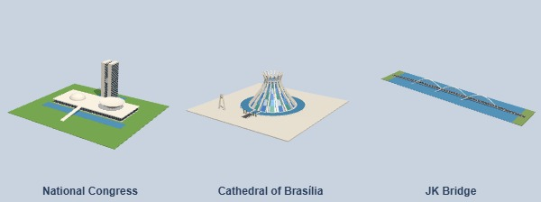

| Prévia | Monumento | Cidade / UF | Descrição | Triângulos | Medidas (L × A × P) | Arquivo |
|---|---|---|---|---|---|---|
|  | **Congresso Nacional**<br>[`congresso_nacional.glb`](modelos/congresso_nacional.glb) | Brasília, DF | As duas torres em H, a cúpula do Senado, a cuba virada da Câmara, a laje longa, a rampa e os espelhos d'água | 2.756 | 300 × 101 × 260 m | 196,6 KB |
|  | **Catedral de Brasília**<br>[`catedral_brasilia.glb`](modelos/catedral_brasilia.glb) | Brasília, DF | 16 colunas curvas de concreto formando um hiperboloide, vitrais azuis, verdes e brancos, o espelho d'água, o campanário e os quatro evangelistas | 3.322 | 150 × 43,1 × 150 m | 249,1 KB |
| 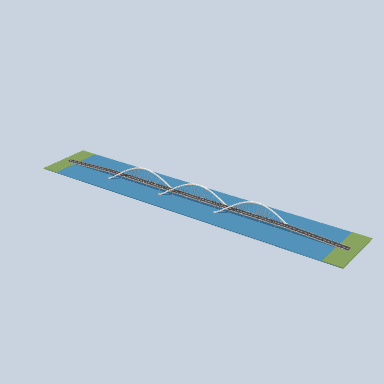 | **Ponte JK**<br>[`ponte_jk.glb`](modelos/ponte_jk.glb) | Brasília, DF | Três arcos de aço assimétricos que cruzam o tabuleiro em diagonal, os pendurais, os pilares e o lago (1,2 km de ponta a ponta) | 3.056 | 1.260 × 65,8 × 220 m | 227,7 KB |

## Nordeste

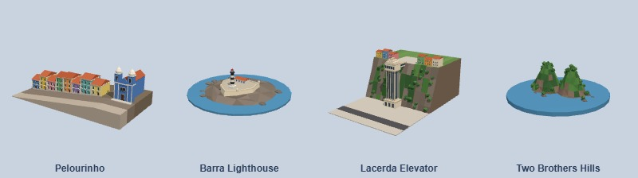

| Prévia | Monumento | Cidade / UF | Descrição | Triângulos | Medidas (L × A × P) | Arquivo |
|---|---|---|---|---|---|---|
|  | **Pelourinho**<br>[`pelourinho.glb`](modelos/pelourinho.glb) | Salvador, BA | Ladeira de casarões coloniais coloridos com sacadas e telhados de telha, e a igreja azul no alto | 2.564 | 92,0 × 32,1 × 48,0 m | 196,4 KB |
| 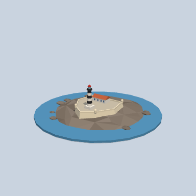 | **Farol da Barra**<br>[`farol_da_barra.glb`](modelos/farol_da_barra.glb) | Salvador, BA | Forte de pedra com guaritas sobre uma ponta rochosa, a casa do faroleiro e o farol listrado em preto e branco | 1.136 | 128 × 35,8 × 128 m | 93,3 KB |
|  | **Elevador Lacerda**<br>[`elevador_lacerda.glb`](modelos/elevador_lacerda.glb) | Salvador, BA | Torre art déco de 72 m ao pé da escarpa, a passarela até a Cidade Alta, o casario no alto e a praça da Cidade Baixa | 2.664 | 120 × 77,4 × 180 m | 234,3 KB |
| 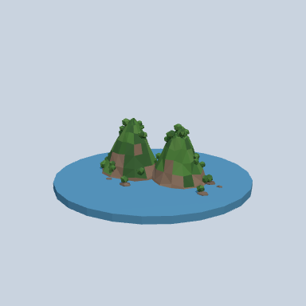 | **Morro Dois Irmãos**<br>[`morro_dois_irmaos.glb`](modelos/morro_dois_irmaos.glb) | Fernando de Noronha, PE | Duas formações rochosas gêmeas saindo do mar, com mata no alto e pedras na linha d'água | 1.620 | 160 × 52,8 × 160 m | 174,9 KB |

## Norte

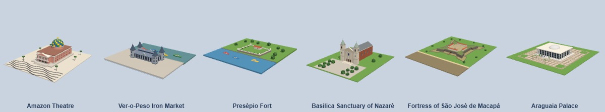

| Prévia | Monumento | Cidade / UF | Descrição | Triângulos | Medidas (L × A × P) | Arquivo |
|---|---|---|---|---|---|---|
| 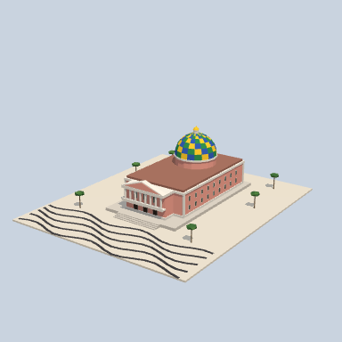 | **Teatro Amazonas**<br>[`teatro_amazonas.glb`](modelos/teatro_amazonas.glb) | Manaus, AM | Teatro de ópera rosa com colunata e frontão brancos, a cúpula de mosaico verde, amarelo e azul e a praça com pavimento em ondas | 3.278 | 120 × 43,7 × 145 m | 251,1 KB |
|  | **Ver-o-Peso**<br>[`ver_o_peso.glb`](modelos/ver_o_peso.glb) | Belém, PA | Mercado de ferro cinza-azulado com quatro torres de canto pontiagudas, o telhado com lanternim, o cais e barcos coloridos no rio | 1.652 | 124 × 30,8 × 115 m | 127,4 KB |

## Pastas

- `modelos/<id>.glb`: um monumento por arquivo.
- `previas/<id>.png`: vista em três quartos de cada modelo, de frente.
- `catalogo.json`: todos os modelos com nomes em português e inglês, cidade, estado, região, descrição, medidas, triângulos e caminhos dos arquivos.
- `docs/`: o mosaico completo, um mosaico por região e a capa.

## Como usar

- **Unidades e eixos:** metros em escala real aproximada, Y para cima, frente voltada para +Z. A origem fica no centro da base, com o nível do chão em Y = 0; a laje do terreno afunda cerca de 1 m e a água do mar ou do rio fica abaixo de 0, então você pode colocar um modelo em terreno plano em Y = 0.
- **Cores:** toda a cor está nas cores por vértice (atributo `COLOR_0`). A maioria dos importadores de glTF as ativa automaticamente; se um modelo aparecer branco, ative as cores por vértice no material dele.
- **Modelos grandes:** as pontes e os morros são grandes (a Ponte JK tem 1,26 km de comprimento). Reduza a escala para um diorama ou mantenha em 1:1 como monumentos de fundo.
- **Web (bibliotecas WebGL em JavaScript):** carregue o `.glb` com o carregador de glTF da biblioteca e adicione a cena; defina `material.vertexColors = true` se for preciso.
- **Motores de jogo de código aberto e comerciais:** arraste o `.glb` para o projeto (ou use o pacote de importação de glTF do motor); cada arquivo é importado como uma malha com dois materiais.
- **Editores 3D:** Arquivo › Importar › glTF 2.0. A camada de cor por vértice se chama `Color`.

```js
const cathedral = (await gltfLoader.loadAsync("modelos/catedral_brasilia.glb")).scene;
cathedral.traverse((o) => { if (o.isMesh) o.material.vertexColors = true; });
scene.add(cathedral);
```

## Perguntas frequentes

**Posso usar esses modelos em um jogo comercial?**
Sim. Eles são de domínio público (CC0 1.0): use, modifique e redistribua sem pedir licença e sem dar crédito. O crédito é bem-vindo (veja [`CITATION.cff`](CITATION.cff)).

**São réplicas exatas?**
Não. São interpretações low poly em escala real aproximada, feitas para serem reconhecíveis de longe: silhuetas, proporções e cores seguem os monumentos reais, mas os detalhes são simplificados.

**Como foram feitos?**
Por código: cada monumento é montado a partir de caixas, vigas, superfícies de revolução e de loft e envoltórias convexas com cor por vértice em um script Python, depois exportado, carregado de volta e renderizado para conferência. Cada malha é um conjunto de cascas fechadas com normais voltadas para fora.

## Mais pacotes gratuitos do mesmo jogo

- [Frota de carros de rali](https://github.com/kayquer/scitizia-frota-64) · [Objetos quebráveis](https://github.com/kayquer/scitizia-props-64) · [Pessoas](https://github.com/kayquer/scitizia-pessoas-64) · [Rodas e pneus](https://github.com/kayquer/scitizia-rodas-64) · [Peças de carro](https://github.com/kayquer/scitizia-pecas-64) · [Cidade](https://github.com/kayquer/scitizia-cidade-64) · [Natureza](https://github.com/kayquer/scitizia-natureza-64)

## Licença

[CC0 1.0 Universal](LICENSE): dedicação ao domínio público por Kayque Rotondo.

## Como citar

Os metadados de citação estão em [`CITATION.cff`](CITATION.cff).
